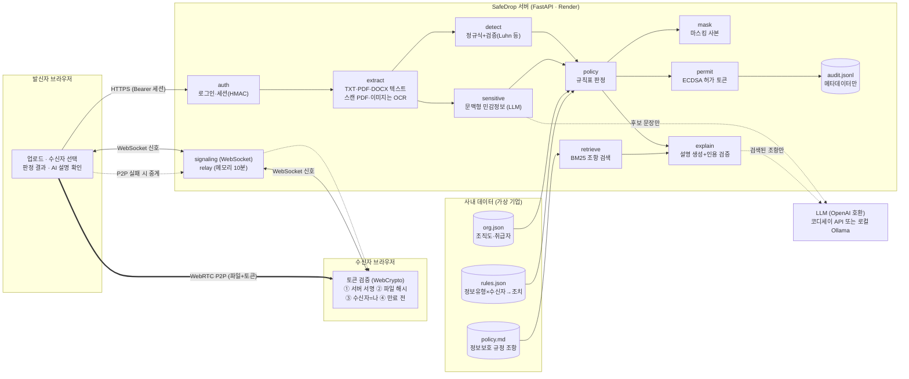
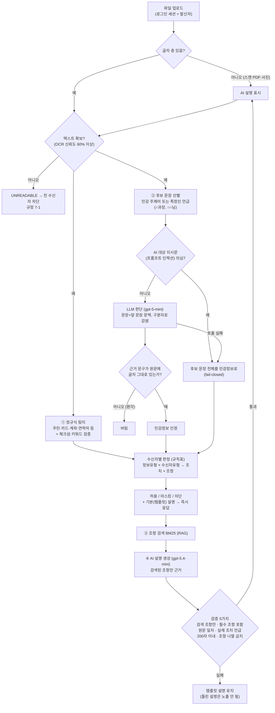
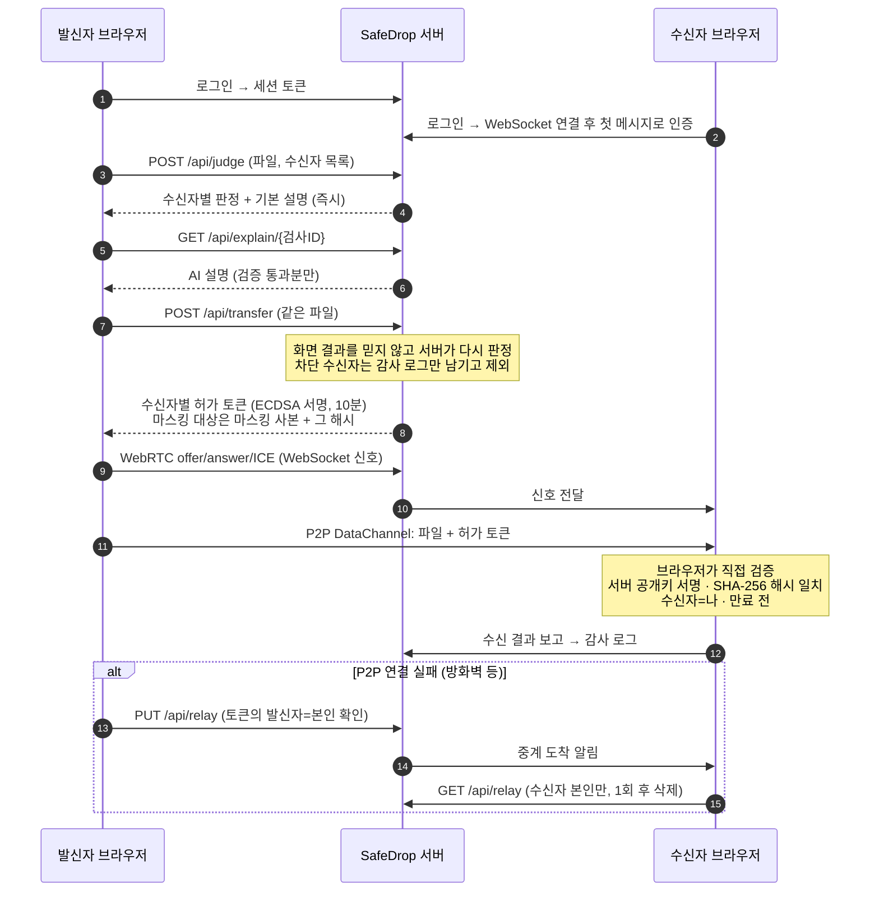

# SafeDrop 아키텍처

> 사내 파일 전송 직전에 민감정보를 탐지하고, **사내 규정 + 수신자 정보**로 수신자마다 허용·마스킹·차단을 판정한 뒤, 서버가 서명한 허가 토큰과 함께 브라우저 간 P2P로 전송하는 웹 서비스.

> 다이어그램 이미지(발표·기획서용): [`img/system.png`](img/system.png) · [`img/pipeline.png`](img/pipeline.png) · [`img/transfer.png`](img/transfer.png)

## 설계 원칙 4가지
| 원칙 | 의미 | 구현 |
|---|---|---|
| **판정은 규칙, AI는 판단·설명** | 허용/마스킹/차단은 규칙표가 결정한다. AI는 "이 문장이 민감한가"와 "왜 그런가"만 답한다 | `policy.py` 규칙표 판정, `sensitive.py`·`explain.py`는 판정에 관여하지 않음 |
| **모르면 막는다 (fail-closed)** | 읽을 수 없거나 AI가 실패·의심스러우면 보수적으로 처리 | 텍스트 추출 불가 → 차단(7-1), AI 실패·프롬프트 인젝션 의심 → 후보 문장을 민감정보로 간주 |
| **화면을 믿지 않는다** | 판정 결과는 서버가 다시 계산하고 서명해서 증명한다 | 전송 시 서버 재판정 → ECDSA 서명 허가 토큰 → 수신 브라우저가 직접 검증 |
| **내용은 남기지 않는다** | 파일은 서버에 저장하지 않고, 기록은 메타데이터만 | P2P 직접 전송, 실패 시 메모리 중계(10분, 꺼내면 삭제), 감사 로그엔 누가·누구에게·조치·조항만 |

## 1. 시스템 구성도

| 모듈 | 역할 | 핵심 |
|---|---|---|
| `auth.py` | 로그인, 세션 | 시연 비밀번호 → HMAC 서명 세션 토큰(8시간, 탭별). 로그인 실패 IP당 1분 5회 |
| `extract.py` | 텍스트 추출 | TXT·PDF(pypdf)·DOCX(python-docx). 글자 층이 없는 스캔 PDF와 이미지(PNG·JPG)는 OCR로 넘김 |
| `ocr.py` | 스캔 문서 OCR | Tesseract(한국어) + 전처리(잡티 제거·자동 이진화), 인터넷·GPU 불필요. 평균 인식 신뢰도 60% 미만·10쪽 초과는 **읽기 불가 → 차단** |
| `detect.py` | 정형 개인정보 탐지 | 주민·외국인등록번호(생년월일 검증), 카드(Luhn), 휴대폰, 이메일, 운전면허, 여권·계좌(키워드 근접) |
| `sensitive.py` | 문맥형 민감정보 | 주제어로 후보 문장만 골라 LLM에 질문. 근거 문구 원문 대조, 실패·인젝션 시 fail-closed |
| `policy.py` | 수신자별 판정 | 수신자 유형(외부 > 취급자 > 같은 부서 > 다른 부서) × 정보 유형 → 가장 엄격한 조치 + 근거 조항 |
| `mask.py` | 마스킹 사본 | 유형별 부분 가림(주민번호 앞 7자리만 등), 민감 문장은 `[민감정보 가림]` |
| `retrieve.py` | 근거 조항 검색 (RAG의 R) | BM25(한국어 글자 2-gram) + 조 제목 태그 필터 |
| `explain.py` | 설명 생성 (RAG의 G) | 검색된 조항만 근거로 설명. 인용 5중 검증 실패 시 템플릿 설명으로 대체 |
| `permit.py` | 전송 허가 토큰 | ECDSA P-256 서명, 10분 만료. 클레임: 전송ID·발신자·수신자·조치·파일명·SHA-256 |
| `transfer.py` | 신호·중계·감사 | WebSocket 신호(인증 필수), 메모리 중계(10분, 1회 꺼내면 삭제), 감사 로그 |
| `main.py` | API | 인증·권한(관리자 전용 감사/측정), 업로드 10MB 제한, 두 단계 응답 |

## 2. 데이터 파이프라인 (판정 흐름)

**왜 이렇게 나눴나**
- 규칙으로 확실히 잡히는 것(번호 형식)은 정규식, 문맥이 필요한 것(누가 어떤 병인지)만 LLM → **비용·속도·정확도**의 균형. 문서 전체가 아니라 후보 문장만 보내므로 긴 문서도 토큰 문제 없음.
- LLM 출력은 그대로 믿지 않고 **코드로 검증**(근거 원문 대조, 인용 검증) → 환각이 판정이나 설명에 섞이지 않음.
- 판단(정확도 중요)은 추론 모델, 설명(속도 중요)은 빠른 모델 → 설명 대기 35.4초 → 2.4초, 인용 검증 통과율 동일(20/20).

### 판정 규칙표 (`rules.json`)
| 정보 유형 \ 수신자 | 취급자 | 같은 부서 | 다른 부서 | 외부 |
|---|---|---|---|---|
| 고유식별정보 (주민번호 등) | 허용 3-1 | 마스킹 3-2 | 마스킹 3-2 | **차단** 3-3 |
| 금융정보 (카드·계좌) | 허용 4-1 | 마스킹 4-2 | 마스킹 4-2 | **차단** 4-3 |
| 연락처 (휴대폰·이메일) | 허용 5-1 | 허용 5-1 | 허용 5-1 | 마스킹 5-2 |
| 민감정보 (건강·신념 등) | 허용 6-1 | 마스킹 6-2 | **차단** 6-3 | **차단** 6-3 |
| 확인 불가 (읽을 수 없음) | **차단** 7-1 | **차단** 7-1 | **차단** 7-1 | **차단** 7-1 |

한 파일에 여러 정보가 있으면 수신자마다 **가장 엄격한 조치**를 적용한다. 수신자를 여러 명 고르면 각자 따로 판정된다(예: 인사팀은 원본, 영업팀은 마스킹본, 협력사는 차단).

## 3. 전송 흐름 (허가 토큰 + P2P)

## 4. 보안 설계
| 위협 | 대응 |
|---|---|
| 다른 직원 행세 (발신자 위장) | 발신자는 클라이언트 값이 아니라 서버가 서명한 세션 토큰에서 결정 |
| 화면 결과 조작 후 전송 | 전송 시 서버가 다시 판정하고, 판정 결과를 서명 토큰에 담음 |
| 파일 바꿔치기 · 다른 사람에게 전달 | 토큰에 파일 SHA-256과 수신자 ID → 수신 브라우저가 검증, 불일치 시 경고 |
| 중계 서버 악용 | 업로드는 유효한 토큰 + 토큰의 발신자 = 로그인 본인, 다운로드는 수신자 본인만, 10분 후 자동 삭제 |
| LLM 환각 | 근거 문구 원문 대조, 설명 인용 5중 검증, 실패 시 템플릿 |
| 프롬프트 인젝션 | 문서를 구분자로 감싸고 내부 지시 무시 규칙, 지시문 패턴 발견 시 AI 판단 미사용(fail-closed) |
| 비밀번호 대입 · 대용량 업로드 | 로그인 실패 제한(IP당 1분 5회), 업로드 10MB 제한 |
| 기록을 통한 유출 | 감사 로그에 파일 내용 미기록, AI 판단 캐시는 해시 기준·판단 결과만 10분 |

## 5. 기술 스택과 배포
| 구분 | 선택 | 이유 |
|---|---|---|
| 백엔드 | Python 3.12, FastAPI, uvicorn | 파일 처리·AI 라이브러리 생태계, 비동기 WebSocket |
| 프런트 | HTML + JavaScript (프레임워크 없음) | WebRTC·WebCrypto가 브라우저 기본 기능, 빌드 과정 불필요 |
| 문서 처리 | pypdf, python-docx | 순수 파이썬, 무료 서버 메모리(512MB) 안에서 동작 |
| OCR | Tesseract 5 (kor), pypdfium2 | 무료 오픈소스, 인터넷·GPU 없이 CPU로 동작 → 폐쇄망 서버에 그대로 설치 가능. 페이지당 약 1~2초 |
| 암호 | cryptography (ECDSA P-256), HMAC-SHA256 | 브라우저 WebCrypto로 검증 가능한 표준 곡선 |
| AI | OpenAI 호환 SDK — 판단 gpt-5-mini, 설명 gpt-5.4-mini | 주소만 바꾸면 로컬 Ollama로 교체 가능(폐쇄망 대응) |
| 배포 | Render 무료 웹 서비스 (Docker, `render.yaml`) | 카드 없이 외부 접속 가능한 HTTPS 주소 |
| 테스트 | pytest 43개 | LLM·네트워크 없이 1초, 가짜 LLM으로 안전장치 검증 |

## 6. 실제 배포 기준 점검과 로드맵
현재 버전은 "한 회사가 서버 1대에 설치해 시범 운영할 수 있는 수준"을 목표로 했다. 실제 전사 배포를 기준으로 부족한 점과 해결 순서는 다음과 같다.

### 6-1. 마감 전에 보강한 것
| 항목 | 내용 |
|---|---|
| 사내(폐쇄망) 설치 묶음 | `deploy/onprem/` — 앱 + Ollama(판단 qwen3:8b, 설명 exaone3.5) docker-compose, 모델 반입 절차, GPU 16GB 1대 기준 |
| 서명 키 고정 | `PERMIT_SIGNING_KEY` 환경변수 → 서버 재시작 후에도 발급한 토큰 유효 (`scripts/gen_secrets.py`) |
| 의존성 버전 고정 | `requirements.txt` 전 항목 버전 고정 → 언제 빌드해도 같은 조합 |
| 감사 로그 보존 | 사내 설치 시 로그 폴더를 컨테이너 밖 볼륨에 저장 |

### 6-2. 로드맵 (실제 배포 전 필요)
| 단계 | 문제 (현재) | 해결 |
|---|---|---|
| **1. 시범 운영 필수** | 공통 시연 비밀번호 로그인 | 사내 계정(SSO/LDAP) 연동, 조직도 자동 동기화 |
| | 차단되면 대안이 "지우고 다시 검사"뿐 | **예외 승인 흐름**: 업무 사유 입력 → 정보보호팀 승인 → 원본 전송 (승인 기록도 감사 로그로) |
| | 이름·주소 단독은 탐지하지 않음 | 이름·주소 패턴 + AI 판단 대상 확대, 실제 업무 문서 수백 건 규모로 재검증 |
| | 한글(HWP·HWPX)·엑셀·PPT 미지원 → 차단 | 문서 형식 추가 (HWPX는 ZIP 안의 XML이라 우선순위 1) |
| | 감사 로그가 파일 | DB 저장, 이전 기록 해시를 잇는 변조 탐지, 법정 보관 기간 적용 |
| **2. 전사 확대** | 서버 메모리에 중계·세션 → 서버 1대만 가능 | 공유 저장소(Redis 등)로 여러 대 운영 |
| | 중계 파일이 서버 메모리에 평문 | 수신자 키로 암호화(종단 간 암호화) |
| | TURN 서버 없음 → 사내망에서 P2P 실패 시 서버 중계 | 사내 TURN 서버 |
| | 마스킹 사본이 .txt | DOCX·PDF 원본 형식 유지 마스킹 |
| | 규정·규칙표 변경 시 재배포 | 정보보호팀용 규정 관리 화면, 변경 시 검색 색인 자동 갱신 |
| | 모니터링 없음 | 오류·처리 시간·AI 호출량 대시보드, 장애 알림 |
| **3. 우회 경로 차단** | SafeDrop 밖(메일·메신저·USB)으로 보내면 검사 없음 | 메일 게이트웨이·사내 메신저 연동, PC 에이전트(기획 단계 로드맵). 판정·설명 엔진은 그대로 재사용 |
| 그 외 | OCR 손글씨·저화질 | GPU 서버가 있으면 딥러닝 OCR로 교체 (모듈 교체 구조) |
| | 프롬프트 인젝션 탐지는 패턴 기반 | 패턴 확장, 판단 결과 교차 검증 |
| | 외부 보안 점검 미실시 | 침투 테스트·의존성 취약점 점검 정기화 |

### 6-3. 서비스 모델 (구상)
| 형태 | 대상 | 근거 |
|---|---|---|
| 사내 설치형 라이선스 | 외부 클라우드를 쓸 수 없는 기업·기관 (금융·공공·의료) | 로컬 LLM으로 외부 전송 없이 동작 (측정 완료), 설치 묶음 |
| 클라우드형(SaaS) | 외부 AI 사용이 허용되는 중소기업 | 같은 코드에 설정만 외부 API로 |
| 규정 맞춤 구성 | 회사별 정보보호 규정 → 규칙표·조항 색인 구성 | 판정이 규칙표라 회사별 커스터마이징이 코드 변경 없이 가능 |
